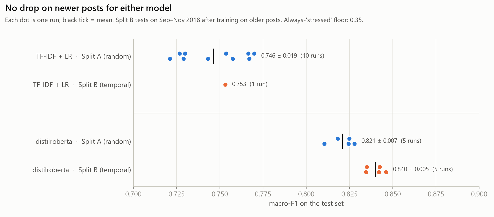
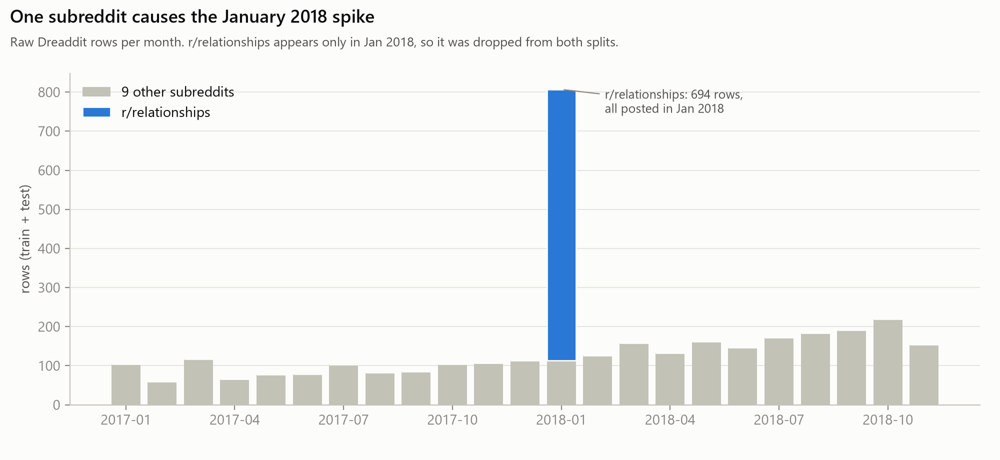
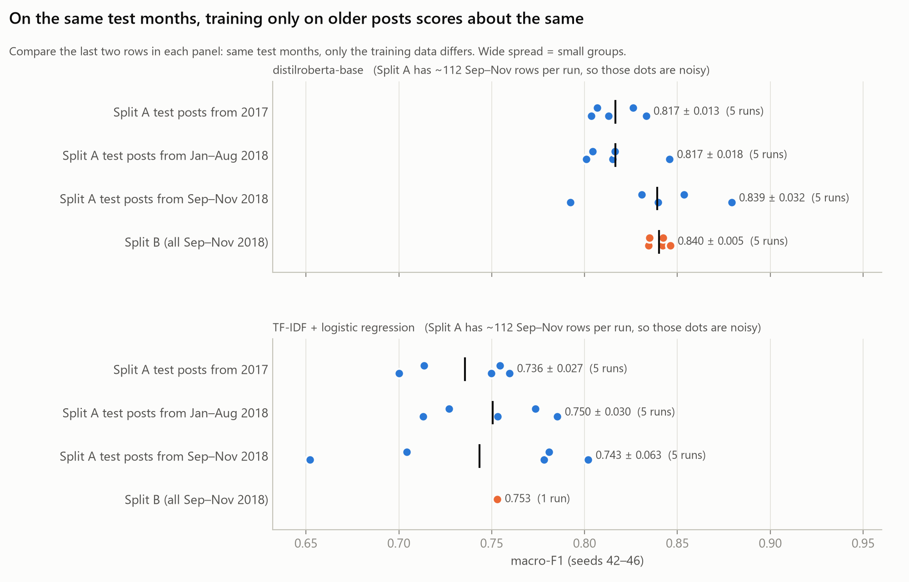

# Does a stress detector hold up over time?

A small-scale test of temporal robustness in stress classification, inspired by
Liu, He & Huang (2024), *"Time Matters: Examine Temporal Effects on Biomedical Language Models."*

**Question.** If a classifier is trained on older Reddit posts, does it perform worse on posts
written later, compared with the usual random train/test split?

**Answer (on this dataset).** No measurable drop. Both a TF-IDF baseline and a fine-tuned
transformer score at least as well on the newest posts as on a random split. The newer posts
score higher overall because those months happen to be easier to classify, not because of
how the model was trained (see [Why Split B scores higher](#why-split-b-scores-higher)).
The time window is short (under two years), so this is evidence of stability over months,
not years.



## Data

[Dreaddit](https://huggingface.co/datasets/andreagasparini/dreaddit) (Turcan & McKeown, 2019):
Reddit posts from 10 subreddits, January 2017 to November 2018, split into short segments and
labelled *stressed* / *not stressed*. Every row has a Unix timestamp (`social_timestamp`), and all
segments of a post share the same timestamp.

**Cleaning.** One subreddit, r/relationships, appears **only in January 2018** (694 rows,
about 20% of the data). Keeping it would make any date-based split also a topic split, so it is
removed from **both** splits. That leaves 2,859 rows from 2,399 posts in 9 subreddits.



## Method

**Two splits, built from the same cleaned data**, so the only difference between them is how posts
are divided:

| | Train | Test | How |
|---|---|---|---|
| **Split A** (random) | ~2,290 rows | ~570 rows | 20% of *posts* held out at random; all segments of a post stay on the same side. Repeated with seeds 42–51 (TF-IDF) or 42–46 (transformer). |
| **Split B** (temporal) | 2,294 rows, Jan 2017 – Aug 2018 | 565 rows, Sep – Nov 2018 | Fixed cutoff at 2018-09-01 00:00 UTC (close to the 80% point). |

**Models**
1. **TF-IDF + logistic regression**: word and two-word-phrase features (`min_df=2`, sublinear TF),
   scikit-learn defaults otherwise. A majority-class model is included as a floor.
2. **distilroberta-base**, fine-tuned for 3 epochs, learning rate 2e-5, batch size 16, max length
   256 tokens (truncates 0.5% of rows), 10% warmup, fp16. All settings were fixed before any test
   score was seen, and no test data was used during training.

**Metrics.** Macro-F1 (main) and accuracy. Split A is reported as mean ± standard deviation over
runs. For the transformer, Split B is also run with 5 seeds, because training itself is random.

## Results

| Model | Split A: random (mean ± std) | Split B: temporal | B − A (macro-F1) |
|---|---|---|---|
| Majority class (floor) | 0.352 ± 0.014 (10 runs) | 0.358 (1 run) | |
| TF-IDF + LR | **0.746 ± 0.019** (10 runs) | **0.753** (1 run) | +0.7 points |
| distilroberta-base | **0.821 ± 0.007** (5 runs) | **0.840 ± 0.005** (5 runs) | +1.9 points |

Accuracy follows the same pattern (TF-IDF: 0.756 ± 0.017 vs 0.765; transformer: 0.824 ± 0.006 vs
0.844). Per-run numbers are in [`results/metrics/baseline_runs.csv`](results/metrics/baseline_runs.csv) and
[`results/metrics/transformer_runs.csv`](results/metrics/transformer_runs.csv).

- The transformer beats TF-IDF by about 8 macro-F1 points on both splits.
- For TF-IDF, Split B falls inside the normal run-to-run range of Split A.
- For the transformer, Split B is **higher** than Split A in every run. The next section explains why.

### Why Split B scores higher

Comparing all of Split A with all of Split B changes two things at once: the training data
(random mix vs. older posts only) **and** the test months (all months vs. Sep–Nov 2018 only).
To separate them, Split A's test predictions are grouped by month, so Split B can be compared
with Split A **on the same test months**:

| Macro-F1 (seeds 42–46) | Split A test posts from 2017 | Jan–Aug 2018 | **Sep–Nov 2018** | **Split B** (Sep–Nov 2018) |
|---|---|---|---|---|
| distilroberta-base | 0.817 | 0.817 | **0.839** | **0.840** |
| TF-IDF + LR | 0.736 | 0.750 | **0.744** | **0.753** |

On the same months, a model trained only on older posts scores about the same as one trained on a
random mix that includes those months (difference: +0.1 points for the transformer, +1.0 for
TF-IDF). For the transformer, the Sep–Nov 2018 posts are simply easier, about 2 points above older
months, and Split B tests *only* those months. TF-IDF shows no such month effect, and why only the
transformer finds these months easier is not known. Split A has only about 112 Sep–Nov rows per run,
so those numbers are noisy (per-run std 0.032 for the transformer, 0.063 for TF-IDF). The result is
"no sign of a cost", not "proven zero cost".



### Additional checks

- **A larger time gap.** Two training sets of exactly 1,100 rows each, tested on Split B's test set
  (TF-IDF, one run each): all of 2017 (about 8 months before the test period) scores **0.734**, and
  the most recent 1,100 rows before the cutoff (no gap) score **0.725**. Older data did not do
  worse. ([fig4](results/figures/fig4_time_gap.png))
- **One random split is not enough.** The dataset's own Hugging Face train/test split gives TF-IDF
  a macro-F1 of 0.718, below all 10 of our random splits (0.721–0.770). A single split would have
  made Split B look misleadingly good, which is why Split A is reported over several seeds.
- **Class balance.** The share of stressed rows is similar across the two sides: 0.538 (train) /
  0.558 (test) for Split B, vs. about 0.54 for Split A. It moves more month to month in 2017, when
  months have fewer posts. ([fig2](results/figures/fig2_stress_over_time.png))

## Limitations

- **Short time span.** The data covers under two years, and Split B's test set starts right where
  training ends. Changes in language that take years to appear would not show up here.
- **Small test groups.** About 565 test rows per split, and about 112 per run for the same-months
  comparison. Small effects (one or two points) cannot be ruled out.
- **GPU training is not exactly repeatable.** Rerunning the transformer with the same seed changed
  single-run macro-F1 by up to about 1.3 points. Means changed by less than 0.2 points. The CSVs in
  `results/metrics/` are from the latest run.
- **r/relationships was removed.** The results describe 9 subreddits, not the full dataset.
- **Few seeds for the transformer** (5 per split). Standard deviations from 5 runs are rough.
- **No hyperparameter tuning.** Both models use common default settings. Tuned models might behave
  differently over time.
- **Small overlap in the original split.** The Hugging Face train/test split shares no post IDs,
  but 3 text segments appear word for word in both (likely the same post submitted to two
  subreddits). This affects only the side-note result.

## Reproduce

```bash
python -m venv .venv
.venv\Scripts\activate            # Windows; on macOS/Linux: source .venv/bin/activate
pip install torch --index-url https://download.pytorch.org/whl/cu130   # GPU build; omit for CPU
pip install -r requirements.txt

python src/download_data.py       # Hugging Face -> data/raw/ (never edited)
python src/prepare_data.py        # -> data/processed/dreaddit_clean.csv
python src/train_baseline.py      # TF-IDF + LR, all splits -> results/metrics/baseline_*.csv
python src/sanity_time_gap.py     # time-gap check -> results/metrics/sanity_time_gap.csv
python src/train_transformer.py   # distilroberta, 10 runs -> results/metrics/transformer_*.csv (GPU recommended)
python src/analyze_predictions.py # breakdowns -> results/metrics/breakdown_*.csv
python src/make_figures.py        # -> results/figures/fig*.png
```

Trained on an NVIDIA RTX 2060 (6 GB). Every script fixes its random seeds (42 and up).

## Repository layout

```
src/
  paths.py                output folders (results/metrics, results/figures), shared by all scripts
  download_data.py        Hugging Face -> data/raw/
  prepare_data.py         combine, drop r/relationships -> data/processed/
  splits.py               Split A (grouped random, seeds 42-51) and Split B (cutoff 2018-09-01)
  evaluate.py             macro-F1 and accuracy, shared by both models
  train_baseline.py       TF-IDF + logistic regression (and majority-class floor)
  train_transformer.py    distilroberta-base fine-tuning
  sanity_time_gap.py      old (2017) vs recent training data, same test set
  analyze_predictions.py  scores by label, period and subreddit
  make_figures.py         all figures
notebooks/
  01_inspect_data.ipynb   data exploration, the r/relationships finding, choosing the cutoff
results/
  metrics/                CSVs: per-run scores (*_runs), summaries (*_summary),
                          test predictions (*_predictions), breakdowns (breakdown_*), time-gap check
  figures/                PNGs: fig1-fig5
data/                     raw/ and processed/ (not in git; recreated by the scripts)
```

## References

- Liu, He & Huang (2024). *Time Matters: Examine Temporal Effects on Biomedical Language Models.*
- Turcan & McKeown (2019). *Dreaddit: A Reddit Dataset for Stress Analysis in Social Media.*
